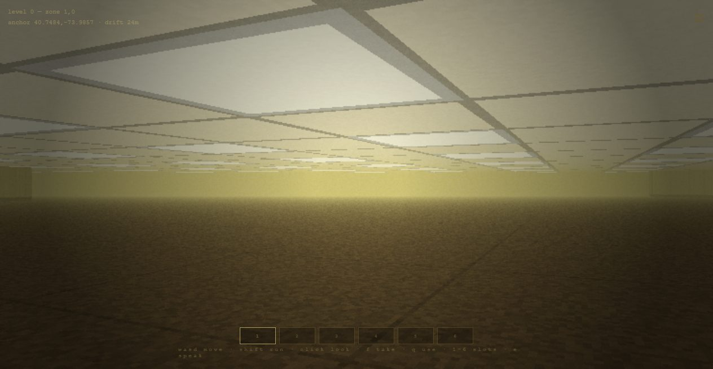
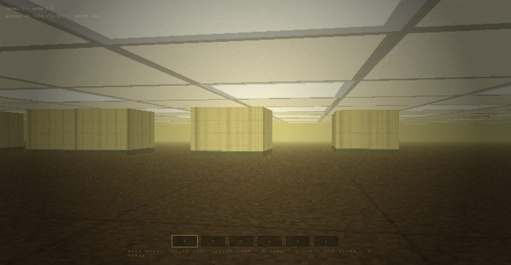
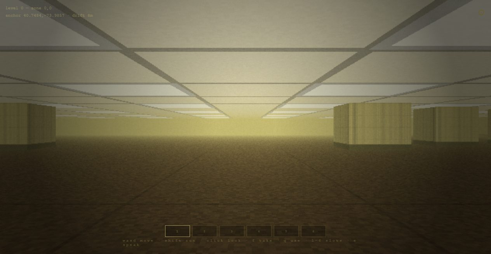
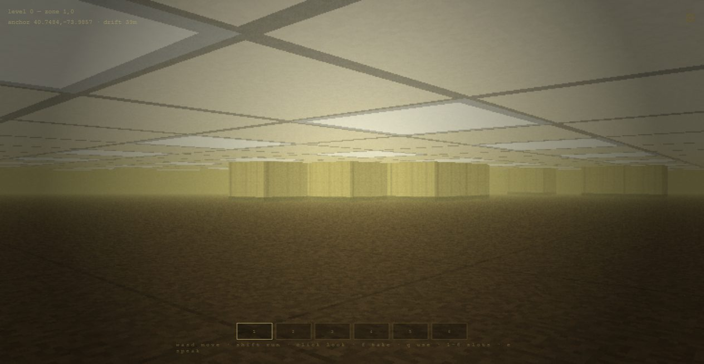
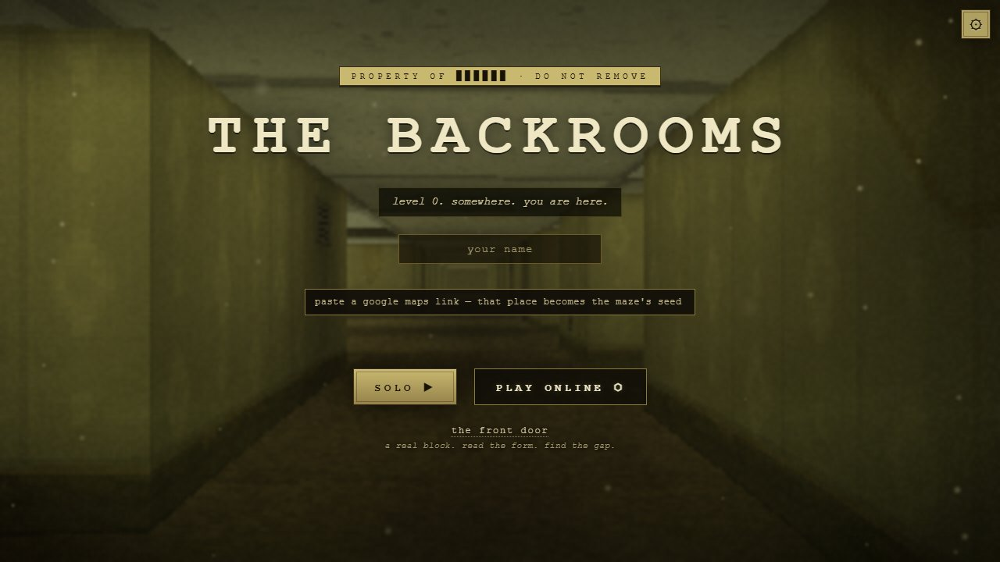

# the backrooms

**[▶ play it in your browser — free, no install](https://backrooms.thecornerspore.dev/play/)** · works on phones too · or [download for windows, macos, linux](../../releases/latest)

> you have no-clipped out of reality.

an infinite procedural first-person horror maze that descends through four levels. fluorescent lights, damp carpet, tight office corridors, no exit — only the way down, and a door at the bottom that climbs back to the lobby.

<p align="center">
  
</p>

<p align="center">
  
  
</p>
<p align="center">
  
  
</p>

<sub>rendered by a hand-written textured raycaster — no game engine, no assets, just math and the colour yellow.</sub>

---

## ▶ the live site — [backrooms.thecornerspore.dev](https://backrooms.thecornerspore.dev/)

<p align="center">
  <b><a href="https://backrooms.thecornerspore.dev/">enter the finding →</a></b><br>
  <a href="https://backrooms.thecornerspore.dev/play/">play in your browser</a> ·
  <a href="https://backrooms.thecornerspore.dev/manual/">the field manual</a> ·
  <a href="https://backrooms.thecornerspore.dev/codex/">the record — the lore</a> ·
  <a href="https://backrooms.thecornerspore.dev/atlas/">the atlas</a> ·
  <a href="https://backrooms.thecornerspore.dev/recover/">the case board</a>
</p>

> **these links render in your browser.** GitHub shows `.html` files inside this repo as *source code*, not as a page — so open the manual and the lore through the links above, not by clicking files under `docs/`.

---

## 📖 the field manual

**[open the illustrated field manual →](https://backrooms.thecornerspore.dev/manual/)**

everything on this page, drawn and in depth: every key, the screen with its parts labelled, the four floors, the things and the one rule each of them keeps, the items, the file the office keeps on you, what friends can do for each other, and the beacon. it renders in any browser. this page is the plain-text version: the same ground, fewer pictures.

---

## install

download the installer for your system from [releases](../../releases/latest) and run it.

| system | file | notes |
|--------|------|-------|
| **windows** | `The-Backrooms-Setup-x.x.x.exe` | one-click install, desktop shortcut |
| **linux** | `The-Backrooms-x.x.x-x86_64.AppImage` | `chmod +x` it and run — updates itself |
| **linux (debian/ubuntu)** | `The-Backrooms-x.x.x-amd64.deb` | `sudo apt install ./The-Backrooms-x.x.x-amd64.deb` |
| **macos** | `The-Backrooms-x.x.x-universal.dmg` | intel + apple silicon. not notarized yet: the first time, right-click the app → **open**, or run `xattr -cr "/Applications/The Backrooms.app"` |

every release also carries `backrooms-server.js`, a small standalone server for playing over a local network — it needs a little setting up; see [multiplayer](#multiplayer).

or don't install anything: [play in your browser](https://backrooms.thecornerspore.dev/play/). it can be installed as an app from the browser menu, plays offline, and keeps a solo run in that browser.

### updates

settings ⚙ → **updates** picks how new versions arrive:

- **automatic** (default) — checks at launch and every few hours, downloads quietly, installs when you quit. a small **restart now** prompt appears if you want it sooner.
- **ask before downloading** — checks the same way, but only tells you a new version exists; nothing downloads until you click **download**.
- **only when i check** — never checks on its own. use **check for updates** in settings whenever you like.

**check for updates** works in every mode. on macos the app tells you about new versions and opens the download page (unsigned mac builds can't replace themselves). in the browser there is nothing to choose: it picks up a new version the next time you open it (sometimes the time after).

### the app, the browser, the phone

it is the same game everywhere, with fewer reaches outside the desktop app.

| | desktop app | browser | phone / tablet |
|---|---|---|---|
| look | click the view to grab the mouse | the same | drag anywhere on the view |
| move | wasd or the arrow keys | the same | the left thumb-stick |
| chat and the field console | **enter** | **enter** | needs a keyboard |
| wishes | posted, and a person reads each one | the same | the same |
| the beacon | fires | stays quiet | no button |
| photographs | saved to `Pictures/backrooms/` | the caption only | the caption only |
| an invite link | copied, opens in any browser | copied | the share sheet |
| host lan · join lan | starts a server · joins one | not offered (an https page cannot reach your network) | not offered |
| updates | settings ⚙ → **updates** | the next time you open it | the next time you open it |

**what is counted.** the site and the browser game at backrooms.thecornerspore.dev carry one cookieless counter, [GoatCounter](https://www.goatcounter.com/), so i know whether anyone came. it counts a page view — which page (always `/` or `/play/`), the site that sent you, your browser and operating system, your language, screen width and country — sets no cookie and stores no IP address. an invite link's room code and pin are taken out of the address before the counter loads, so no room code or pin is ever sent to it, and neither is a name, a wish or the chat. the desktop app and the itch.io copy count nothing.

### if it misbehaves

- **it freezes on some graphics cards** (desktop): settings ⚙ → **software rendering**, then restart.
- **it is slow or hot:** settings ⚙ → **graphics quality** → low, or **classic shading**, the plainest and fastest light. **frame-rate limit** saves battery.
- **it hangs:** when the window stops responding, the desktop app waits a few seconds and reloads it, and keeps a `backrooms.log` in its data folder. attach it to an issue.
- **in the browser,** adding `?gfxbench=1` to the address runs a one-minute benchmark of your device instead of the title, and `?gfxstats=1` shows a small diagnostics panel while you play. [docs/gfx-device-testing.md](docs/gfx-device-testing.md) explains both.

---

## how it begins

you fall into the lobby — yellow wallpaper, wet carpet, the hum. nothing hunts you there. below it, things do.

there is another way in, for when you mean it. under the buttons on the title screen sits a quiet line, **the front door**: *a real block. read the form. find the gap.* behind it you open your eyes outside, in a real place — an inner-block park in harlem park, west baltimore, under a flat grey sky, ringed by the backs of rowhouses whose doors have been sealed with concrete block. near the stoops lies a form. your name is already on it, or a blank is where your name should be. the address line says *woodyear st. (the street goes on. the block does not.)* you never filled it in. there is one way out: a gap the paperwork left. take it and you fall into the lobby.

the first time you take a way down — the lobby's way to level 1, or the block's gap if you came in by the front door — an office somewhere above the drop ceiling writes you into a column, by how you came in. it never asks. and the backrooms reads what it wrote: how far the things can see you, what the water does to you, what a photograph develops, what the lost souls see on you. the form it writes on is never far: `/intake` reads it anywhere.

after that it is the descent — four floors stacked in one building, a way down on each, and at the bottom a door that climbs back to the top. somewhere in the paperwork a notice, *30150A*, has said EXTENSION for twenty-one years. once the office can hear you, it will let you choose a word of your own. the lost souls talk about the thirteen who complied. *nobody remembers them. that was the point.*

online, you and your friends start together in the lobby, and the file is written on all of you.

what follows is what is known. the rest is in the pages m. left lying around.

---

## the first ten minutes

1. **the title.** type a name, or leave it blank — the office writes down what you give it. above the buttons, the anchor field takes a place if you want one ([anchors](#anchors--no-clip-from-a-real-place)); leave it empty and the maze is nobody's. **SOLO ▶** starts a fresh run in the lobby. **CONTINUE ▶** appears once a solo run is saved; starting SOLO (or the front door) over it replaces it, and there is no second slot. the gear ⚙ opens settings — creatures, damage and flicker can all be switched off there.
2. **grab the mouse.** click the view. the mouse turns you left and right; there is no looking up or down. a page, the chat or the wish box lets the mouse go — click again to take it back. while it is loose, **←** and **→** turn you.
3. **the lobby.** walk with **wasd**; **shift** runs. safe; nothing hunts here. learn it. pick things up (**f**), draw from a vending machine (**f**), search a cabinet (**f**, then keep still), read a page lying on the floor (**e**), open the map (**tab**). the plate above your items always says what **f** and **e** will do where you stand. before long, `• • •  e · speak  • • •` will appear over your items though there is nothing to see. that is a presence. [say something to it](#the-wish-system).
4. **the way down.** a torn doorway with a cold blue rim and a beam that carries through the fog. the compass under your gauges points at the nearest one you have seen. **f** takes it — and this is when the file writes you in. a line, a few seconds after you land, says how it has you.
5. **level 1.** things live here now. read the lines that fade in mid-screen: the building talks, and the important lines push in front. when your heart comes into your ears, something has you. **space** pushes it back. a still body in the dark is hard to see. and if it catches you anyway, you wake a floor up, a little lighter.
6. **the front door, when you mean it.** the line under the title's buttons starts a solo run on **the block**, level ∅ — the one real place in the game. find the form near the stoops and press **e** to read it. then find the gap: `f · no-clip out — level 0`. press **f**. nothing leads back up to the block.

**the game never pauses.** settings, the map, a page, the chat and the wish box all leave the world running behind them, and the things keep moving. there is no quit menu: close the window. a solo run saves as it goes.

the keys you need first: **wasd** walk · **shift** run · click to look · **f** take, search, go through · **e** speak, read · **space** ward · **l** light · **q** use · **tab** map. every key is under [controls](#controls).

---

## anchors — no-clip from a real place

the anchor field sits above the buttons on the title screen: *paste a google maps link — that place becomes the maze's seed.* the full link from a computer's address bar works, so does a dropped pin's link, the short link a phone's share button gives you (`maps.app.goo.gl/…`), or the two numbers, `lat,lng`. you will fall through *that* place. the same place always produces the same maze — for everyone.

a short link has no place in it, so the game asks the relay where it leads (*looking for that place…*). only the link is sent — never the words a share sheet puts around it — and only the two numbers come back. a place that cannot be read says *that place cannot be found.*, and the run starts without a pin. the level plate shows your drift — how far you have wandered from where this floor set you down — and settings ⚙ has **locate your body**, which opens google maps at the spot where you fell through (desktop app only).

anchored worlds hold their shape. unanchored worlds forget you were ever there.

hosting with an anchor carries the whole room down with you — the first player into a room decides its world. join someone else's room and the pin you pasted stays yours: the others are told only a mark, enough to know whether you fell through the same place they did. the pin itself never goes to the other players — unless you put it in an [invite link](#invite-links) yourself.

---

## your instruments

top-left, under the level's name, two gauges — and one more at the bottom:

- **hp** is your body. the things in the fog take it; bandages and time bring it back — it starts to regrow once nothing has touched you for a while.
- **san** is your mind. the dark eats at it, so does depth, so does being hunted, so does a thing you cannot stop looking at — and light, sweet water, a page you have not read and a friend standing close give it back. let it run low and the edges of the screen stain violet, the whispers come, and the floor finds more ways to frighten you. it will not kill you.
- **your legs** are the thin bar at the bottom left; it shows only when they are tired. running and warding spend them.

once the file has you, the things hunt movement. stand still and make no sound, light and radio off, and after a breath they lose sight of you — until you move, call out, or push. if not all of you arrived, you vanish faster. (that is being [thin](#the-file--who-you-are).)

the lost souls say it their own way: *if the lights go out, stop moving. it hunts movement.*

under the gauges sits the compass: an arrow to the nearest way on that you have *seen*, and how far — or, when you have seen none, *something pulls, faintly*. a `~` before it means the building has moved under that mark. a second line points back the way you came. above the item dock, a prompt says what **f** or **e** will do where you stand. the lines that fade in mid-screen are the building talking; your people talk in the chat at the lower left.

the whole screen speaks too. it flashes red when you are hit, closes in violet when your mind runs low, and goes dark while you are down, lifting as a friend counts you back. with a pin, the level plate also shows your drift.

---

## the descent

every run begins in **the lobby**. the one real place in the game, **the block**, sits outside the stack, behind the front door on the title screen: you go there on purpose, solo. after that the maze is a stack of levels, and each one has a way on. a way looks like a torn doorway standing in the fog: a cold blue rim that breathes, a ring on the floor, a beam you can see from far off. walk up to it and press **f**.

| level | what it is | the way on |
|-------|-----------|--------------|
| **∅ — the block** | behind the front door. a real inner-block park in harlem park, west baltimore, under open grey sky. rowhouse backs of formstone, brick, plywood with sprayed house numbers, doors sealed with concrete, black open windows, marble stoops. some houses are lived in — a light on, nobody comes out. a plan cleared the street out of the block and left this. no creatures. one form. | the front doors are sealed with block. the only way out is the gap the paperwork left — no-clip through it and fall into the lobby. **one way, once.** |
| **0 — the lobby** | mono-yellow rooms, damp carpet, the fluorescent hum, offices with cabinets and chairs, muzak that is not quite right. safe: nothing hunts here. the most pages. | *the walls are thin here* — no-clip through a torn corner and fall out of the lobby. |
| **1 — habitable zone** | colder concrete, dim service lights, storerooms of crates and pallets. *you are not the only thing awake here.* | a hole in the floor down to the pipes. a **stairwell up** under some of the holes above. and somewhere, standing uncalled, a **lift**. |
| **2 — pipe dreams** | maintenance tunnels with no lights of their own. steam, rust, pump rooms, and the dark between the pipes. *level 2. bring your own light.* the radio starts reading numbers here. | a service hatch down into the dark, or a stairwell back up. |
| **3 — electrical station** | a lightless labyrinth of transformers, live cable and switch rooms. *the deepest you should go.* | a door humming with current — through it, the lobby waits again. or a stairwell back up. |

descend and the world changes around you: the palette, the fog, the clutter, the music, and what is in it with you. your hit points and your inventory come with you.

**one building.** the floors are stacked: fall through a hole and you land a few rooms over from where you fell, on the floor below. under some holes there is a **stairwell up**, back to the floor you fell from. the **lift** on level 1 *only goes one place*, and it does not come back for you. the humming door at the bottom climbs out to the lobby, where you last stood in it. the way you just came through is *still closing* for a moment after you arrive. and anything that was hunting you when you went down may come after you: *it followed you down.*

**the floors remember.** what you took stays taken, the drawers you searched stay searched, what you set down lies where you left it, and an emptied machine clunks again only after you have been away a while — never while you watch. *the machine has been refilled. by whom.* come back and the floor says so: *you have been on this floor before.*

**when something finally has you,** you do not wake where you fell in: you wake a floor above, beside the hole you fell through, lighter — whatever was in your hand is gone, your body's ceiling a little lower — the hp bar never quite fills again — the trays empty until you move on. on the lobby you wake where you are. every floor you reach for the first time gives a little of the ceiling back. online, with a friend on your floor, you may go [down instead](#multiplayer).

---

## the map

press **tab** and a sheet of paper rises over the lower part of the view, drawn in pencil. *you start drawing. it is the only way to know you are moving.*

it holds only what you have actually walked, plus small marks for what you have *seen*, even far down a hall. every floor keeps its own sheet, between visits and (solo) across a quit. the map is held, not a pause: while it is up you walk at half pace, cannot run, cannot use anything or ward, and a hit knocks it out of your hands. **tab** or **esc** folds it. on a touch screen it is the paper corner marked *map* under the gauges. there is no map on the block.

| mark | what it is |
|---|---|
| ▽ | a way down, or the climb out |
| △ | a stairwell up |
| ◇ | the lift |
| ⊟ / ⊠ | a vending machine / one you emptied |
| ✶ | a landmark |
| ¶ | a page — faint until you read it |
| ○ | where you arrived on this floor |
| × | where you were hurt |
| ◌ | a way that was there |
| · | something else — a soul, a place that was wrong |

the footer is the only tally of your walking: `level 1 — habitable zone · 212 cells walked · 3 down · 1 up`.

the compass under your gauges reads the same sheet. it points only at ways that lead on, and only at ones you have seen. walk alone, with no pin, and sooner or later you will find that *the hole is not where you drew it.*

---

## the things

nothing in the lobby hunts. below it, things do. they **hear** — a walk barely carries, a run carries round corners, a push of will carries further, a whistle further still, and sound follows the halls, not straight through walls. they **see** only along a clear line; on the dark floors they see less, and your own light helps them. walls block them. furniture does not, but a furnished room makes them come round corners.

they go still when they hear something, come to the noise, hunt you once they see you (*it has seen you.*), and search where they lost you. break the line and keep quiet, and they lose you. *you have lost it. it is still looking.* running down a hole does not shake one.

each kind keeps one rule. the wanderers wrote some of them on the walls long before you got here:

- some things only move when you are not looking. *it stops when you look. do not look away.*
- *stay away from the ones that walk on all fours.* one of them gathers itself before it comes. *push now.*
- *bring a light to the pipes. the dark there is not empty.*
- something in the pipes lies still in the dark, and waits for your light to leave it.
- something never touches you at all. it only watches. watching back is what costs you.
- on the deepest floor the lights drop for a breath before the current finds you. a wall between you is enough.

**not everything is a thing.** the lights go out ahead of you one by one, and come back. a door slams somewhere far off. *the hum stops. the silence has a shape.* footsteps keep your pace. a figure crosses the intersection ahead, and the hall is empty when you look again. none of it can touch you, though a cold spot takes a little of your mind.

and some places are wrong every time you pass them. *the chairs have been moved. nobody moved them.* a haunting never hurts you, never comes toward you, and never happens while something real is near. so: **a figure that stands still is the building. one that moves is not.** the map marks the place.

don't want them at all? settings ⚙ → **creatures** off, for a pure liminal wander.

---

## the fight

you are not defenceless. face a thing that hunts you and press **space** — a **ward**, a shove of will and light. tap it for a wide, short push. hold it and your steps slow while the air tightens; let go for a narrower, longer push that throws farther. whatever it catches reels back and runs, then stops and turns to face you — *it stops. it turns.* push it again in that moment and it counts for more: *you catch it turning. it reels.* keep at it and it comes apart entirely, *in the light*, and that stretch of the floor stays empty for a while.

warding and running are the same budget: your legs. sprint away and you may have nothing left to push with — *nothing left in your legs to push with.* a ward is loud, too.

the rest of the fight is what you carry and where you stand:

- **the flash.** a polaroid blinds whatever is in front of you for a moment. some things turn and run from it.
- **the lure.** turn a radio on (**q**), then set it down (**x**). it keeps talking, and the things go to it instead of you.
- **quiet water.** sweet almond water softens your steps for a while.
- **the line.** corners, doors and furnished rooms break sight. a cornered thing turns on you: *it has nowhere to go. it turns.*
- **stillness.** once the file has you, stand still and dark and silent, and you are hard to find.
- **your light.** some things stop for it. some things hunt by it.
- **a still moment.** where things hunt, a bandage takes a moment of standing still to wrap. a hit makes it slip — and you keep the bandage.

**listen to your heart.** while something hunts you, your heartbeat comes into your ears, faster the closer it gets, and the floor's own song thickens around it. *it is close.* when you lose it, the music takes a long breath before it sounds like itself again.

if you want the dread and not the danger, settings ⚙ → **can take damage** off.

---

## between encounters

the backrooms restocks itself. things are left lying around; walk close and press **f**. six slots. `1–6` selects, `q` uses, `x` sets it down. *your hands are full* when all six are taken. some things are worth carrying, some are worth using where you found them, some are worth leaving behind.

| item | use (q) |
|------|---------|
| almond water | the main mend: your legs, your mind, the lights hold steady and your steps go soft for a while. from the pipes down, some of what the machines and drawers give is sour, and sour water takes instead of gives. *don't trust the almond water on the deeper floors.* |
| glowstick | pushes the fog back — less the deeper you go. set one down and it is a breadcrumb until *the green light gutters out.* |
| bandage | patches you up — restores hit points. where things hunt, wrapping it takes a still moment, and a hit makes it slip; you keep it. deeper down it holds better. carry a few before you go deep. |
| polaroid camera | one shot each. the flash blinds what is in front of you, and the picture steadies you. the caption develops what the frame holds — sometimes more than you aimed at. photograph a lost soul and, faintly, there is a door behind them. point it at a friend and the film develops what the file wrote on them, and they will know. the desktop app keeps every shot in `Pictures/backrooms/`. |
| radio | never used up. while it plays a presence can be found from much farther away — but you cannot hide with it on, and some things see you further. set it down still talking and they go to it instead of you. on levels 2 and 3 it reads a list aloud, one group of numbers at a time — the numbers station. |

on the deepest floors the machines sometimes give stranger things. these you keep — you cannot put them down, and they are not lost when something has you:

| find | what it is |
|------|---------|
| survey plumb | a tool, never used up. it reads the grain of the floor — slack near the top, tight and old below |
| ballast | set both feet and mean it: your legs and the lights come back. if not all of you arrived ([thin](#the-file--who-you-are)), the rest of you does |
| extension slip | *notice 30150A.* a line the system never closed. what it says depends on what the file has written on you |

**vending machines.** `f · draw from the machine`. each gives one thing, once; an emptied one is ⊠ on your map. it refills only after you have been away a while. after something has you, every tray is empty until you take a way. *the tray is empty.*

**drawers.** a cabinet, a crate, a box, a drum, a panel, a cart or a couch can be searched: `f · search the cabinet`. press **f** once and keep still a moment — a step away leaves it, and nothing may be close (*not now.*). mostly there are words, sometimes nothing, sometimes a find, and rarely the building answers instead. it makes a little noise. *something counts the drawers you open.*

**m.'s pages.** 26 of them, lying on the floors, out of order. read one with **e**. together they are one story — someone who signs *m.*, the tallies and the graffiti answering each other, and further down, something stranger. the first time you read a page it steadies you, and it goes on your map. they hold real advice: *rule i learned today: the almond water is real. drink it. the dark drinks you back if you do not.*

**lost souls.** pale, still people. press **e** to speak to one. some of what they say is true. *the way down is near the torn wallpaper. never a way up.* — they have been here a long time, and the building has changed around them.

**landmarks.** rare things you can steer by, starred on your map. *a payphone. the cord has been cut. it is ringing.*

**leave a word.** press **x** to set something down, and a card offers six phrases lifted from the pages — m.'s and the replies left beside them. pick one with a number (or **0** for nothing) and the thing becomes a **cache**: it lies where it fell, with an arrow for the way you were facing. *take the left.* *the dark drinks you back.* *i am close behind.*

- **who sees it.** whoever comes to it. the prompt tells them before they take it — say your friend is called maddie: *f · take the bandage · left by maddie*. taking it, they read the phrase, the arrow turned to where *they* stand, and who left it. a stranger's word steadies you, a little.
- **how long it lasts.** the floor remembers your caches between visits and across a quit. online, the room sees them as you set them down, and the relay keeps the last of them for whoever comes through after you — come back to a room and your own words are still yours.
- **which words.** at first everyone is offered the same six for that floor and that kind of thing; once the pages you have read hold six of the twelve phrases, the card offers only words from those. the more of the record you find, the more of it you can say.
- **no free text, ever** — only what is written on the pages. and a hand needs a moment between two words: set a second one down in the same breath and it stays in your hands (*your hands are not ready.*).

**the field console.** press **enter**, solo too, and type a line that starts with `/`. `/status` reads your file, `/intake` the form. `/recover`, `/cases` and `/file <answer>` work through the field recovery cases — instruments to read on the floors, answers to file. progress is shared with [the case board](https://backrooms.thecornerspore.dev/recover/) in the same browser. the cases are kept online, on the site — the desktop app and the itch.io copy read them from there too; without a connection, *no signal.* online, `/invite` copies a link to your room ([invite links](#invite-links)).

---

## the wish system

while wandering, you may encounter a presence. there is nothing to see — only, over your items, `• • •  e · speak  • • •`. one waits close to where you first reach the lobby. carry a radio that is playing and you will notice them from much farther off.

press **e** to speak. *state your request.* type anything. **enter** starts a new line rather than sending; press **submit**, or **cancel** to walk away (**esc** does not close it while you are typing). the faint lines under the box are things you may say. at first there is only one: *a notice was mailed to you. you have not answered.*

wishes are real. from every copy — the desktop app, the browser, a phone — what you say to the wall is posted publicly, and a person reads it. every one. some are granted, by hand. when a wish is granted, the world drifts — palette shifts, sounds change, items grow scarce or plentiful, messages grow more specific — and everyone walks into the changed building: in the browser once the site is next updated, in the desktop app once an update carries it. players notice the world is not quite as it was. the spirits answer, or they don't. because it is posted, put nothing real about yourself in a wish.

the spirits decide. or rather, i do.

---

## the file — who you are

> *the file has you now.*

somewhere above the drop ceiling there is an office, and it keeps a file on everyone who falls through. you never fill it in. it fills itself in — and the backrooms reads it.

**the column.** nobody chooses one. the first way you take down, the file writes you in by how you came in — whether you gave it a name, a place, nothing at all, or opened a room yourself. a line tells you which, a few seconds after you land:

| column | the file says | what it feels like down here |
|------|---------|---------|
| **tenant** | *it has you at an address.* | the street does not mind you; the deep frays you faster. the floors seem to show you their ways. some of the sealed doors on the block were written for you. |
| **anchored** | *it has your body at a pin.* | the body stays where you fell through. drift too far from it and it pulls — settings ⚙ shows the *leash*. a photograph quiets it for a while. |
| **unnamed** | *it cannot spell you.* | the things cannot keep hold of you; a page or a friend steadies you more. the presence listens when you tell it your name. |
| **processed** | *it opened a line on you.* | only ever online or over a lan. the souls see the stamp. sour water costs you nothing — a line moves in a ledger instead. the radio has more to say to you than to anyone. your wishes are amendments. |

and over any of them, a layer: **thin**. drop into a room someone already walks, or come back from dying once the file has you, and *not all of you arrived*. the things lose you faster and hear you less — but light does not sit on you the way it did, and a ward pushes you back too. ballast cures it.

until the first way down nothing is written. `/intake` reads the form anywhere; behind the front door, on the block, it lies near the stoops (**e**). *the file does not take amendments. it takes forms.*

**filed under.** the file also keeps a **status**, and this one is yours to choose. it begins as a notice nobody answered. once the file can hear you — the numbers station has read you its last group, or you have found five of m.'s pages, or you are deep enough — a presence offers three stamps under the request. tap one, or type it. a file that already holds something — a closing reached, pages given up — is asked on the card first, because a new word lets go of all of it:

| status | what it turns inside out |
|------|---------|
| **extension** · *let it stay open* | the deep holds you and the street frays you. sour water stops taking anything — somewhere, the numbers station reads one group further. |
| **compliance** · *close the file* | the film turns honest. a page you have not read comes **sealed**: read it, or leave it unread (**x**) and give it to the file. |
| **litigation** · *contest it* | the claim develops on every photograph, even on the dark floors. a thin figure in frame is evidence. |

the lost souls know which word you are under, and so does the room — *entered the level, filed under extension.* the office files once a real day; after that, *the office is closed. come back tomorrow.* and the status is not part of any save: it follows you into every run, and into every room.

**three ways a file closes.** each status has its ending, and none of them is a door out.

- **extension** — the stand. the deep is home. once the numbers station has finished reading to you, the dark on the deepest floor can be stood in, and the lights tell you when it is counting. *twenty-two years.*
- **compliance** — thirteen pages given up unread. what happens at thirteen is between you and the presence. *the thirteen who complied — nobody remembers them. that was the point.*
- **litigation** — the seam, the oldest ending in the building. the numbers station is counting toward something. the extension slip names the one line the system never closed. the souls under it say: *write it where the dark can read it. then write it again.* the rest is in the pages m. left lying around. there is an ending. it isn't an exit.

**your file** (settings ⚙) shows what the office has on you — the word you are under and since when, how the file has you, and each step of your closing, marked `· done` as you take it. it never says how. it is the only hint the office gives. a **request a new notice** button puts you back under the notice nobody answered (once a day: the old file stays closed); if the old file holds a closing or pages given up, it asks once before it lets them go. solo or online, press **enter** and type `/status` for the same lines.

**the floors keep count.** a wish sent from a filed run carries its word with it — `filed under: EXTENSION · level 2` — and the floors keep count of them. a floor whose files lean one way leans with them: its machines stock for it and stamp the tray (*the tray is stamped COMPLIANCE.*), its pages and souls come more or less often, and the radio on the near floors reads the floor's roll call. who is standing on the floor with you moves it too. so far, nothing has been filed long enough for any floor to lean. *the station reads the floor. nothing is filed here.*

---

## controls

| key | action |
|-----|--------|
| wasd | move / strafe |
| arrow keys | ↑ ↓ walk · ← → turn (while the mouse is loose) |
| shift | run — loud, and it spends your legs |
| click | grab the mouse to look (left and right only) |
| space (hold to charge) | **ward** — tap to shove the things back; hold it and your steps slow while the air tightens, then a narrower, longer push throws them farther (costs your legs) |
| f | take an item · draw from a machine · take a way — no-clip through an exit, climb a stairwell, step into the lift |
| f · search a cabinet | by a cabinet, crate, box, toolbox, drum, panel, cart or couch: press once and keep still a moment, and the drawer gives up what it holds — a step away leaves it; not while something is close |
| f · kneel | online, by a friend who is down: face them and press f to stay with them — your light on, holding still — and count them back. f again, a step, space or esc gets up |
| tab | the map (hold your pace) |
| q | use the selected item |
| x · set down | set the selected item down where you stand, with a phrase lifted from the pages and an arrow for whoever finds it — a talking radio keeps talking where it lies |
| c · whistle | call out — a two-note whistle the floor and your friends hear; the things hear it too |
| l | flashlight on / off — tap it, don't hold it. go dark in a friend's light and the things see you less |
| 1–6 | select an inventory slot |
| e | speak to a presence or a lost soul · read a page, or the form on the block |
| enter | chat (in online play) — and the field console, solo too: `/status` (your file), `/intake` (the form), `/recover` · `/cases` · `/file <answer>` (field recovery), `/me` (an emote, online), `/invite` (a link to your room) |
| b | fire your beacon — your own webhook, set in settings ⚙; it fires only from the desktop app |
| m | mute / unmute the music |
| n | next track — cycle the ambient beds, or back to the floor's own song |
| esc | close settings, a page, the map or the chat line, and let the mouse go. not the wish box while you are typing in it — use **cancel** |

while you are down you cannot move or use anything; **c**, **enter** and **tab** still work.

**the beacon (b)** pushes a signal out of the maze to a phone or a channel you set up — settings ⚙ → **signal / beacon**; desktop app only. it is the one thing in here that reaches out there. some files say it can carry more than a cry for help. [the beacon, in the manual →](https://backrooms.thecornerspore.dev/manual/#beacon)

**on a phone or tablet** the left thumb has a stick (push it forward to the rim to run) and a drag anywhere else looks around. the buttons on the right are **ACT** (f), **USE** (q), **WARD** (space — hold it to charge), **SPEAK** (e), **LIGHT** (l) and **CALL** (c). tap a slot to select it, **✕** to set it down, and the paper corner marked *map* for the map. tap a page to put it back. a few keys have no button yet: the beacon (**b**), the chat and the field console (**enter**) and the music (**m**, **n**) need a keyboard.

your **hit points** sit under the level name, top-left — [your instruments](#your-instruments) reads the rest of the screen.

---

## settings

hit the gear ⚙ (top-right) for the control panel — on the title screen or mid-run; esc, **CLOSE** or a click outside it puts it away. the world does not stop while it is open. everything is optional, and your choices persist between runs:

| toggle | what it does |
|--------|--------------|
| updates | desktop: **automatic**, **ask before downloading** or **only when i check** — see [updates](#updates); **check for updates** sits right under it |
| software rendering | desktop: fixes freezing on some GPUs (restart to apply). it does nothing in the browser |
| music | the generative bed on/off, plus a volume slider |
| ambience | the fluorescent hum, drone, and distant events, plus a volume slider |
| film grain / particles / crosshair / head-bob | visual feel — the particles are the dust, the steam and the sparks |
| mouse sensitivity | look speed (the touch drag follows it too) |
| creatures | below level 0: turn every entity off for pure liminal exploration |
| solid furniture | walk around things — the chairs, crates, cabinets and machines have bodies, and so do the things in the fog; off, you pass through everything but the walls |
| can take damage | off for a peaceful, no-stakes wander: the things still come, and cannot hurt you |
| graphics quality | **auto** adapts to your device; or pick low, medium or high — **classic shading** is the plainest, fastest light |
| reduce flicker | softer light dips, a gentler camera flash and less screen shake. it follows your system's reduced-motion setting until you choose |
| frame-rate limit | none, 60 or 30 fps — saves battery and heat |
| sharp on high-DPI screens | a crisper picture on a dense display; uses more power (not with classic shading) |
| beacon effect / target | what **b** fires: off, an ntfy.sh topic, a discord webhook or your own https url. desktop app only |
| locate your body | anchored runs: opens google maps at the spot where you fell through, with the leash when the file has you at a pin (desktop app only) |
| your file | what the office has on you, once a run is under way — the word you are under, how the file has you, how far your closing has come — and **request a new notice** |

---

## multiplayer

type your **name**, hit **PLAY ONLINE**, pick a **room code** — the box comes pre-filled with a random one — and share it. (empty the box and you land in the one shared room called `default`, with every stranger who did the same.) anyone who enters the same code falls into the same world — anywhere on the internet, no host and no port-forwarding. it runs on a small always-on Cloudflare relay (`relay/`). you see each other as pale figures with nameplates and a small health bar, and **press enter to chat**. the chat is not moderated: use a made-up name, and type nothing real about yourself.

- **PLAY ONLINE** — the public relay + a room code (the easy way).
- **HOST LAN** — the desktop app starts a server on this machine (port 8765 — or, if that is taken, a port the system picks; the plate shows which) in the room `backrooms`, and a plate on your screen shows the address: `HOSTING · JOIN LAN → ws://192.168.x.x:8765`.
- **JOIN LAN** — type the address from your friend's plate and the room. same network.
- **lan is the desktop app's.** an https page is not allowed to open a `ws://` address on your network, so the browser game at backrooms.thecornerspore.dev and the itch.io copy do not show HOST LAN or JOIN LAN at all.
- **the standalone server** ships as `backrooms-server.js` on each release. put it in a folder with a `package.json` of `{"type":"module","dependencies":{"ws":"^8"}}`, run `npm install`, then `node backrooms-server.js` (node 22 or newer). it listens on port 8765, and once an hour it looks for a newer release and replaces itself.
- the first person into a room fixes its world; everyone else inherits it.
- online, everyone starts in the lobby together, as a solo run does — the front door is for solo runs only — and the file writes each of you in on your first way down. how you arrive is written down: opening a room is not the same as dropping into one someone already walks (*not all of you arrived* — see **thin**, above).
- online runs are not saved. the room keeps its world, and you fall back into it.

### invite links

a room can be handed over as a link: `https://backrooms.thecornerspore.dev/play/?room=CODE`. whoever opens it gets the title screen with *a door was left open · room CODE* and one button, **JOIN ▶**. their name field stays theirs — the link never chooses a name for anyone.

- **from the PLAY ONLINE box:** **copy invite link** copies the link for the code in the field. on a phone it reads **send invite** and opens the share sheet. if the clipboard refuses, the link is shown, selected, to copy by hand.
- **in a game:** `/invite` copies your room's link and prints it too. on a lan it names the address and room for JOIN LAN instead; alone, *no one can follow you here. play online and leave a door open.*
- **your place stays out unless you put it in.** the box's **include my place** is off on every load and never remembered, and ticking it says at once: *a pin in a link is a place in a link. don't share your home, and don't paste this on stream.* with a pin in the field, the first press of **copy invite link** says that again and copies nothing; the second puts the pin in the link. in a game, `/invite pin` says the same and copies nothing; a second `/invite pin` puts the pin in the link. a link with a pin carries `&anchor=lat,lng`, fills the friend's anchor field, and adds *the first one in decides the world.* — the pin shapes the maze only if the room is new.
- the desktop app copies the same web link, which opens in any browser. a friend on the desktop app can just type the code.

down there you can do a few things for each other — call out, leave a word, light the way, push the dark back, photograph, count each other back. **update together:** these pass only between copies of this release; an older copy still walks beside you, drawn as a plain figure, but it hears none of them. on **PLAY ONLINE** they ride one new kind of message the public relay has to carry, so a room on a relay that has not been updated plays as it always did — walking, chat and nameplates, nothing more. **HOST LAN** from this release carries them from the start.

**if your friends cannot hear your whistle online,** the relay has not caught up with this release yet. HOST LAN carries everything.

**running your own relay** (a fork, or a copy of this one): redeploy it with every release that changes what rides it — `cd relay && npx wrangler deploy` — and point `RELAY_URL` in `src/renderer/index.html`, `RELAY_HTTP` in `src/renderer/site.js` (the short-link lookup) and `WISH_URL` in `src/renderer/wish-post.js` at your worker. a phone's short map links resolve only once your relay serves `/maps`, and wishes are filed only once it serves `/wish` with its own token. the details are under [the relay](#the-relay-maintainer-notes).

**the whistle (c).** call out, and everyone on your floor hears two notes at a pitch that is only yours — panned to where you stand, fainter the farther you are, with a line in their chat that says *near*, *far* or *very far*, and which way. the hall counts who has answered lately and tells you, in words: *two of you, counting yourself.* a friend standing beside you who has not whistled back yet is not counted — *nobody has answered yet.* a friend who goes a long while without a whistle, a word, or standing near you has gone quiet, and you will feel it. *it has been a while since maddie. the hall is quiet.* alone, the hall keeps the sound. sometimes it does not, and the pitch that answers is wrong. the things hear every call — a whistle carries further than a ward. you can whistle while you are down. on a phone it is the **CALL** button.

**company.** a friend standing close steadies your mind — for a while. *you have been standing together a long time. it stops helping.* step apart, and it comes back.

**a friend's light (l).** the things see by light. once you have taken your first way down, stand dark in a friend's flashlight — a few steps from them, nothing between you — and the things in the fog have a harder time finding you, and the dark eats at you slower. the game names whose light it is when you go dark in it. their light helps the people standing in it, never the one carrying it.

**push for each other (space).** the things are not the same things on every screen. when a friend wards, everyone on that floor feels it where the friend stands: what was in front of them reels, or comes apart, on your side too — and if you were standing in front of their push when it met something, it steadies you. *maddie pushes the dark off you.*

**evidence (the polaroid).** photograph a friend and the film develops what the file wrote on them — and the photograph reaches them. *someone has evidence of you. you are harder to erase.* for a while their mind will not sink far, and the others see them solid, however thin they have become. photograph a friend who is down and they are counted back at once.

**down, not dead.** with a friend on your floor, a hit that would kill you lays you **down** instead: your light goes out and you have twenty-five seconds in the dark. *you are still here. somewhere, someone may notice.* you can still whistle, chat and read your map. a friend who finds you, faces you and presses **f** stays with you — light on, holding still — and counts you back. a photograph does it faster. if nobody comes, it is a death — *nobody came.* — and a friend who is down too cannot come: when everyone on the floor is lying down, the hit kills you as it always did.

---

## save & continue

solo runs auto-save — your level, position, hit points and whole inventory, what every floor remembers of you, the pages you have read, the words you left with things, who the file has you as, and the sheets of your map — every few seconds, on every way you take, when you set something down or pick it up, when something has you, and when you quit. **CONTINUE** on the title screen drops you back exactly where you left off — on the block too, if that is where you were. if that spot has since closed, *you woke somewhere slightly else.*

your mind and your legs start fresh when you continue, and so does whatever the deep was in the middle of telling you. the status you are filed under is not in the save at all: it is the office's, and it follows you into every run and every room.

**SOLO** or **the front door** with a save present starts over and replaces it — there is only one. online runs are not saved; the room keeps its world, and you fall back into it.

---

## the world

the maze goes on in every direction, and forgets what is far behind you. walk a solo run with no pin far enough and come back, and the world may not remember what it was. it is not trying to confuse you. it simply does not care.

it is rendered with a hand-written textured raycaster — damp wallpaper, drop-ceiling tiles lit by flickering fluorescent panels, mottled carpet, film grain. no game engine, no assets, just math and the colour yellow. the flicker deepens the further down you go. if the lights hold, something is holding them.

the sound is the same: **generative weirdcore music**, synthesised live and never looping. detuned pads breathe under a music-box melody that is almost-but-not-quite right, washed through a reverb built from noise, with tape wow-and-flutter and the occasional pitch that slides away. every level tunes it to its own mood — muzak in the lobby, curdled below, drifting in the pipes, dissonant at the bottom, dead air on the block. no `.mp3`, no loop point; it writes itself as you walk. press **m** to silence it, **n** for one of the other beds.

---

## building from source

```bash
npm install
npm start           # run the desktop app from source
npm test            # the unit suite (vitest)
npm run pack        # an unpacked app in dist/, quick to check
npm run dist        # installers for this OS into dist/ (windows signing uses CSC_LINK, CSC_KEY_PASSWORD)
npm run dist:win    # or dist:linux, dist:mac — one platform's installers
```

the LAN server runs from source as `node server/index.js` (`PORT` sets the port, default 8765; `--evlog` or `EV_LOG=1` keeps caches for later arrivals); run that way it never updates itself. the release bundles it into `backrooms-server.js` with `npx esbuild server/index.js --bundle --platform=node --format=esm --outfile=dist/backrooms-server.js --external:ws --define:__BACKROOMS_VERSION__='"<version>"'` — the version is stamped in at build time. because `ws` is left out of the bundle and the file is esm, it runs only beside a `package.json` with `"type":"module"` and `ws` installed (see [multiplayer](#multiplayer)). only a file named `backrooms-server.js` that carries a stamped version updates itself: once an hour it checks the latest release, replaces itself in place, and restarts with the same arguments. a bundle built by hand without the `--define` never does.

the browser build is a flat copy of `src/` for the site's `/play/`, `world.json` included, so a granted wish reaches the browser when the site is rebuilt and deployed:

```bash
PLAY_SW_VERSION=<n> bash tools/build-play.sh src <gh-pages>/play          # the site's /play/ (PLAY_TARGET=site, the default)
bash tools/build-itch.sh src dist/backrooms-web-<version>.zip               # the same bundle as a zip for itch.io, game jolt, newgrounds
```

bump `<n>` on every site rebuild so installed copies fetch the new one (the site now ships 22; the next rebuild is 23). there is no default: the site target refuses to build without it, so a rebuild can never repeat a cache name by accident. the site target adds the GoatCounter tag (`GOATCOUNTER_CODE`, default `backrooms`, counting at `https://backrooms.goatcounter.com/count` with the path pinned to `/play/`) behind a line that takes `room` and `anchor` out of the address first, and a service worker. `build-itch.sh` runs the same script with `PLAY_TARGET=itch` — no counter, no service worker — and checks the zip before it writes it: `index.html` at the root, at most 1000 files, no path over 240 characters, no absolute paths, no `goatcounter`, no token, no `build-config.json`. both bundles carry `LICENSE` and `LICENSE-LORE.md`.

### releasing

1. bump `version` in `package.json` and write `docs/release-notes/v<version>.md` — it becomes the release's notes.
2. push to `main`. **Build & Release** creates a draft release, builds the windows, linux and macos installers, the LAN server and the web zip (`backrooms-web-<version>.zip`) into it, and publishes it only once every required file has landed, so updaters never see half a release. pull requests and manual runs build the same files as artifacts and publish nothing. a push whose version is already published skips the build.
3. no build carries a token. every copy of the game sends a wish to the relay's `/wish`, and the relay files it with its own token (below). the `ISSUES_TOKEN` secret and `src/build-config.json` are no longer read by anything. **before publishing 2.0.0, revoke the token that was stored as `ISSUES_TOKEN`** (github.com/settings/tokens; it shipped inside every earlier installer, in `app.asar`, and those installers stay downloadable), then delete the `ISSUES_TOKEN` repository secret. create the relay's `GITHUB_TOKEN` as a new fine-grained token: this repository only, issues read and write, nothing else.
4. once the release is public, the itch job pushes the same files to itch.io with butler (pinned): channels `windows` (.exe), `linux` (.AppImage), `mac` (the `-universal.zip`) and `html5` (the web zip), to `vars.ITCH_GAME` (default `sasha-thecornerspore/the-backrooms`). until the `BUTLER_API_KEY` secret exists it skips with a notice, and the release is untouched either way. **before adding that secret, pin butler's checksum:** download the butler build the workflow names (`BUTLER_VERSION`, from `broth.itch.zone/butler/linux-amd64/<version>/archive/default`), run `sha256sum` on it and put the result in `BUTLER_SHA256` in `.github/workflows/build-release.yml`. with no checksum pinned the job stops before it runs butler; the key reaches only the two steps that check for it and push.
5. if the release changes what rides the relay, redeploy it (below), and rebuild `/play/` on the site with it.

---

## the relay (maintainer notes)

every co-op verb (the whistle, a cache and its taking, the kneel, a friend's ward, a photograph, the `here` heartbeat) rides one relayed message type, `ev`. a release that adds or changes one needs the relay redeployed with it (`cd relay && npx wrangler deploy`), or PLAY ONLINE rooms will not carry it. decide the keep/drop log on purpose: the relay keeps the last caches a room set down for whoever joins later — in the room's memory, so a room that sleeps forgets them — unless its `EV_LOG` var is `'0'`; the standalone node server (`node backrooms-server.js`) keeps them only with `--evlog` or `EV_LOG=1`, and HOST LAN only when the app was started with `EV_LOG=1`.

besides the rooms, the relay answers two plain requests:

- **`POST /wish`** — `{text, meta, version?}` → `{ok, number}` or `{ok:false, reason}`. it files the wish as a github issue in `GITHUB_REPO` (a var in `wrangler.jsonc`) with its own token. it refuses — silently, as far as the player can tell — text that is empty or over 500 characters, slurs (`words`), links (markdown and `//host` ones too), invites, email addresses, markup and html comments, an `@` written as an entity, another repository's issue (`owner/repo#1`) and ad spam (`spam`), more than 3 wishes in 10 minutes or 10 a day from one sender (`rate`), more than 300 a day from everyone together (`rate`), and any browser origin but the site and the itch CDN — a request with no `Origin` (the desktop app's main process) is let in, `null` and `file://` are not. an `@` a name could follow is filed with a zero-width space after it, so a wish pings no one and `@3am` still arrives. a body is read no further than 4 KB. without its token it answers 503 `closed`. a dev run (`electron .`) sends nothing; a local copy on `localhost` is refused by origin.
- **`GET /maps?u=<link>`** → `{lat, lng}`. it resolves only `https://maps.app.goo.gl/<id>` and `https://goo.gl/maps/<id>` (an ios `?g_st=` tag is fine), follows at most 3 redirects and only to `https://(www.)google.com/maps`, and returns the coordinates and nothing else. the title's anchor field uses it for a phone's short link; until a relay serves it, every short link reads *that place cannot be found.*

both are rate-limited per sender by the **Gate** durable object, named by a salted hash of the IP — an IPv4 address, or an IPv6 address's /64, since one line is handed a whole /64 to pick from — and `/wish` also by one shared Gate named `global`; each keeps only the times of recent requests and forgets them a day after the last. `/maps` also answers the desktop page's own origins (`null`, `file://`). invocation logs are off for the whole worker, so the relay logs nothing about a request.

- **secrets:** `GITHUB_TOKEN` (required for `/wish`: a fine-grained token on this repository with issues read and write, nothing else) and `IP_SALT` (optional; without it a built-in salt is used). set them with `npx wrangler secret put <NAME>` from `relay/`.
- **migrations:** `v1` adds `Room`, `v2` adds `Gate`. `wrangler deploy` applies them.
- **deploy from a full checkout.** `relay/` imports `src/wish-labels.js`, `src/renderer/origin-intake.js` and `src/renderer/anchor.js`, so a wish's title and labels, and a link's coordinates, match the game by construction.

---

## wish pipeline (maintainer notes)

**during the launch, a person reads every wish and grants it by hand.** the auto-arbiter is paused.

1. a player submits a wish from any copy of the game — the desktop app, the browser, a phone, itch.io — and the relay files it: a github issue titled `[WISH] <first line>`, labelled `wish`, `pending` (plus `status:<word>` when filed, and `amendment` from a processed player). a filed wish ends with its trailer, `filed under: EXTENSION · level 2`. the body's last line says where it came from: `submitted from backrooms v<version>`, or `submitted from backrooms on the web`.
2. review the issue — edit the body to your interpretation if needed.
3. label `granted` → **Grant Wish** has claude (claude code on the maintainer's subscription, `CLAUDE_CODE_OAUTH_TOKEN`) rewrite `src/renderer/world.json` subtly, recounts the docket (`node tools/docket.mjs`), validates it (`node tools/validate-world.mjs`), and opens a PR with a patch version bump.
4. review the diff, adjust if needed, merge. nothing a stranger types reaches `main` without that merge.
5. the release builds automatically and desktop players auto-update. the browser has it once `/play/` is rebuilt and deployed; itch.io with the next release's push.

**the auto-arbiter is paused.** **Auto-Grant Wishes (48h)** has no schedule for the launch; it runs only when started by hand from the Actions tab. when run, it takes the oldest wish still `pending` after 48 hours: a flat 20 % are denied (*the spirits did not answer.*); the rest claude arbitrates — grant, partial or deny, with one short in-fiction note — and a grant is recounted, validated, tested and committed straight to `main`. to resume it, put back `schedule: - cron: '23 */6 * * *'` under `on:` in `.github/workflows/wish-auto.yml` (the comment at its top shows it). (its push uses the workflow's own `GITHUB_TOKEN`, so **Build & Release** does not run for it — a personal or app token, such as a `RELEASE_PUSH_TOKEN` secret, makes an auto-grant ship by itself.) a denial labels the issue `denied` and closes it.

**the docket** is the count of wish trailers per floor and status, recounted from the issues on every grant (never incremented) and written into `world.json`; both workflows run `tools/docket.mjs` (it needs `GH_TOKEN`). it ships at 2.0.0 with every count zero.

---

## license

the code is [MIT](LICENSE), copyright (c) 2026 Corner Spore. the lore and text drawn from the backrooms canon — the site's lore pages and the codex, the field manual's prose, the canon-derived lines the game says, and the message pool in `world.json` — are [CC BY-SA 3.0](https://creativecommons.org/licenses/by-sa/3.0/), the licence of the [Backrooms Wiki on Wikidot](http://backrooms-wiki.wikidot.com/) they come from. [LICENSE-LORE.md](LICENSE-LORE.md) says exactly which is which, and how to credit it. this game is not affiliated with or endorsed by the wiki or its authors.
